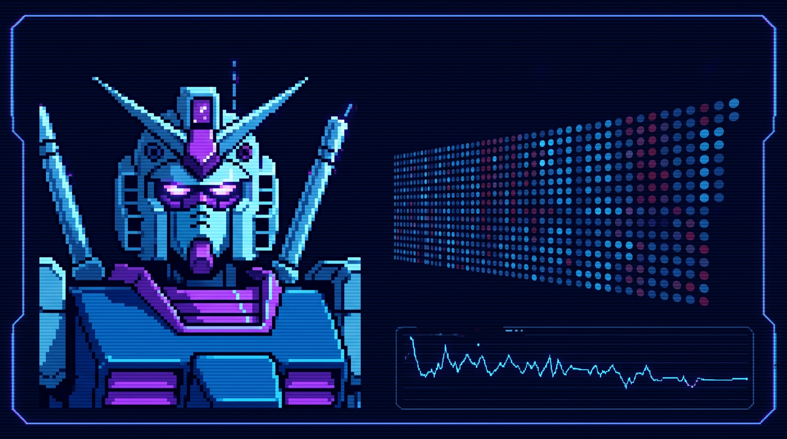

<!-- Header Banner Gelombang (Versi Stabil) -->

  
  
    

  <!-- Auto-Typing Text -->
  
  
    

  <!-- Profile Views Counter -->
  

 

---

### 👨‍💻 About Me 

Seorang Tech Enthusiat yang lagi eksplorasi Artificial Intelligence, Cybersecurity, dan IT Dev.

- 🎯 **Main Goals:**  Develop agent AI *multimodal* dan aplikasi berbasis data.
- 💡 **Spesialist:** Python, LLM (Google Gemini API, Hugging Face), and *rapid prototyping* using Streamlit.
- 🏋️‍♂️ **Daily Routine:** Full Time as an L2 Security Operation Center Analyst
- 📫 **Let's Moots:** <a href="mailto:rizkiangga866@gmail.com">Kirim Email</a> | <a href="https://barokahweb-solutions.netlify.app/bws.html">Manage Service</a>

 

<!-- Visual Animasi Gundam & Data Grid -->

  

 

---

### 🛠️ Tech Stack & Tools 

<table align="center">
  <tr>
    <td align="center" width="33%"><b>🧠 AI & Machine Learning</b></td>
    <td align="center" width="33%"><b>💻 Web & Frontend</b></td>
    <td align="center" width="33%"><b>☁️ Cloud & Database</b></td>
  </tr>
  <tr>
    <td align="center">
       
       
      
    </td>
    <td align="center">
       
       
      
    </td>
    <td align="center">
       
       
      
    </td>
  </tr>
</table>

  <b>IDE & Environments:</b>  
   
   

 

---

### 🚀 Project Showcase 

Beberapa solusi digital yang telah dikembangkan:

| Nama Project | Detail & Deskripsi | Teknologi yang Digunakan |
| :--- | :--- | :--- |
| 🎓 **[SkoolMath AI 2.0](https://chatbot-mathai.streamlit.app/)** | Asisten cerdas EdTech dengan *Triple-Fallback Architecture*, memori RAG interaktif, penjelasan audio (*Text-to-Speech*), dan *dynamic graph plotting*. | `Python` `Streamlit` `Gemini API` `PDF Generation` |
| 🏢 **HRD Chatbot YRI** | Apps chatbot khusus internal HRD Distrik Jakarta Banten untuk mengelola informasi dari referensi dataset dokumen via Google Drive. | `Python` `Streamlit` `PyCharm` |
| 🎨 **Tools SOC** | Advance prompting untuk menghasilkan struktur *website* fungsional dari data operasional direktori lokal. | `Prompt Engineering` `AI Generation` |
| 💼 **[Barokah Web Solutions](https://barokahweb-solutions.netlify.app/bws.html)** | Layanan pembuatan *website*, integrasi aset modern, serta penyusunan komponen UI bersih tanpa batas (*borderless*). | `HTML/CSS` `UI/Design` |

 

---

  <i>"Menulis kode dengan pikiran jernih, membangun sistem yang berdampak."</i>  
  
  <!-- Social Media Badges -->
  

